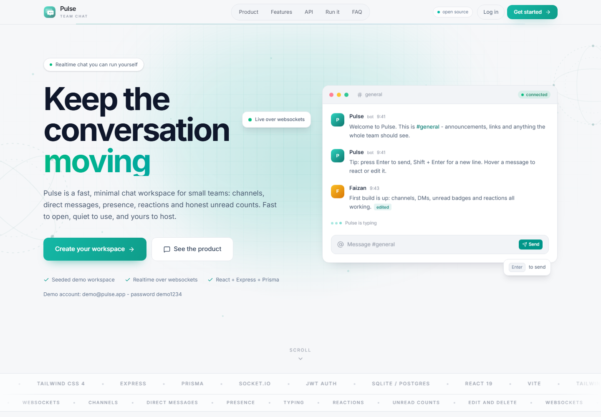
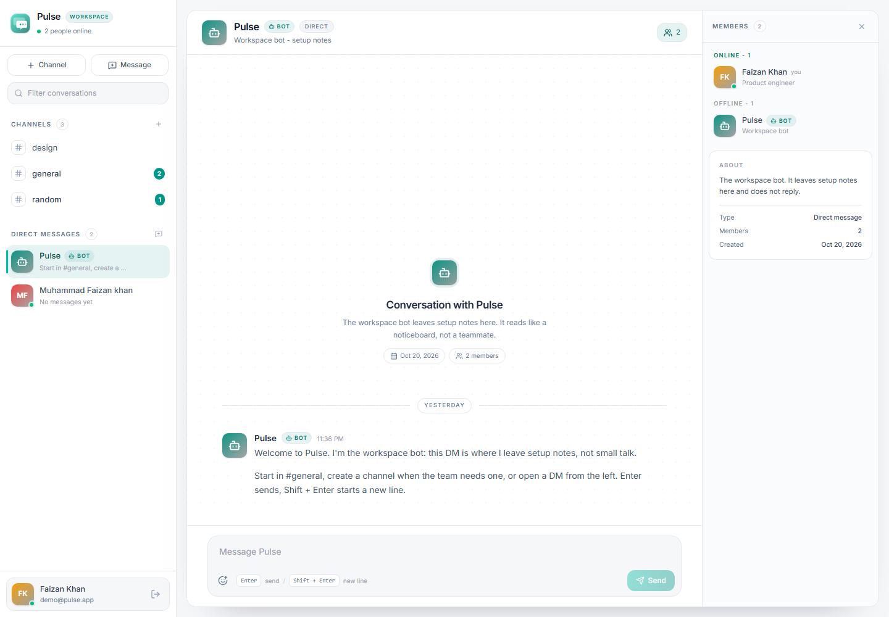
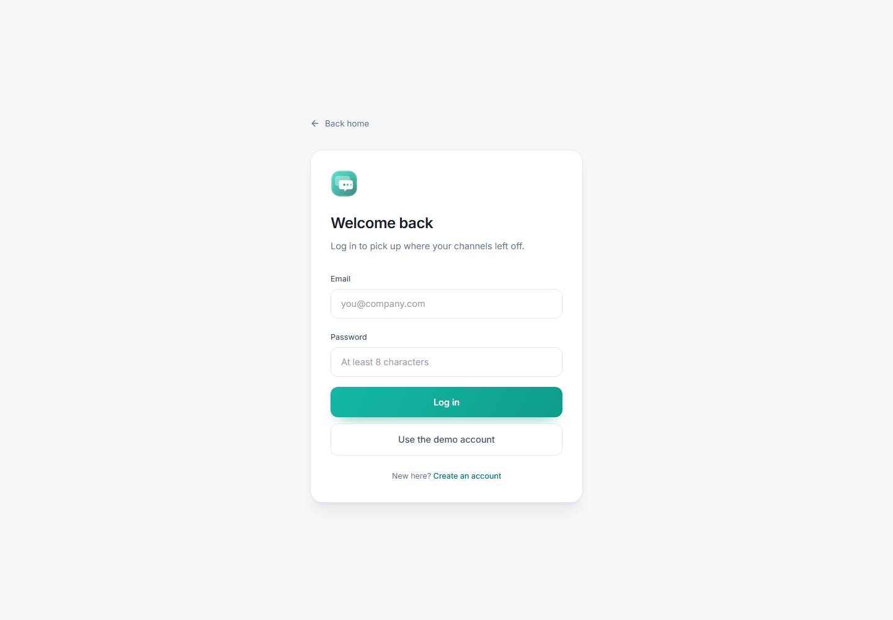
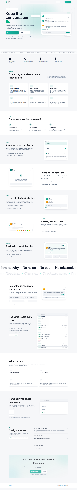

# Pulse

**A fast, minimal realtime chat workspace for small teams.**

Channels, direct messages, presence, typing indicators, reactions and honest unread counts. One repository, two apps, no vendor lock-in.

[](https://github.com/Faizan-khan144/pulse/actions/workflows/ci.yml)
[](./LICENSE)
[](https://react.dev)
[](https://vite.dev)
[](https://nodejs.org)



## What it is

- **Channels** for work the whole team should see, with topics and per-channel read state.
- **Direct messages** between two people. Same composer, same shortcuts, nothing broadcast.
- **Live delivery** over Socket.IO when a socket is available, with a five second polling fallback when it is not.
- **Presence and typing** that expire on their own instead of getting stuck.
- **Reactions, edits and deletes** scoped to the person who wrote the message.
- **A workspace bot** that greets you in a DM and then stops. It is labelled `BOT`, it never pretends to be a teammate, and it never invents a reply.
- **Real numbers everywhere.** The demo workspace ships with three channels, six seed messages and two accounts because that is exactly what the seed creates.

No tracking scripts, no fake activity feed, no enterprise settings maze.

## Screenshots

| Landing | Workspace |
| --- | --- |
|  |  |

| Login | Full page |
| --- | --- |
|  |  |

## Stack

| Layer | Choice |
| --- | --- |
| Client | React 19, Vite 7, Tailwind CSS v4, React Router 7, lucide-react |
| Realtime | Socket.IO (server + client) |
| Server | Express 5, Prisma 6, JWT, bcryptjs |
| Database | SQLite locally, Postgres on Vercel/Neon |
| Deploy | Vercel services (`client` + `server`) |

## Quick start

Requirements: Node 20 or newer (`.nvmrc` pins 22).

```bash
git clone https://github.com/Faizan-khan144/pulse.git
cd pulse

# API
cd server
npm install
cp .env.example .env
npx prisma db push
npm run db:seed
npm run dev

# Client, in a second terminal
cd ../client
npm install
npm run dev
```

Open **http://localhost:5174**. The API listens on **http://localhost:4100**.

Demo account: `demo@pulse.app` / `demo1234`

> The demo bot DM is created lazily the first time the workspace loads, so it exists for every account, not just the seeded one.

## Environment

### `server/.env`

| Variable | Required | Description |
| --- | --- | --- |
| `DATABASE_URL` | yes | `file:./dev.db` locally, Postgres URL in production |
| `JWT_SECRET` | yes | Long random string. Rotating it signs everyone out |
| `CLIENT_ORIGIN` | yes | Comma separated allowed origins, e.g. `http://localhost:5174` |
| `PORT` | no | API port, defaults to `4100` |

### `client/.env`

| Variable | Default | Description |
| --- | --- | --- |
| `VITE_API_URL` | empty | API origin. Empty uses the Vite proxy locally and the same origin in production |
| `VITE_SOCKET_URL` | empty | Socket origin, defaults to the API origin |
| `VITE_REALTIME` | empty | Set to `live` to force sockets in a production build |

Sockets are always on in development. In production the client only connects when `VITE_REALTIME=live`; otherwise it polls, which is what serverless deployments need.

## Scripts

### Client

| Script | What it does |
| --- | --- |
| `npm run dev` | Vite dev server on port 5174 |
| `npm run build` | Production build into `client/dist` |
| `npm run preview` | Preview the production build |

### Server

| Script | What it does |
| --- | --- |
| `npm run dev` | Node watch mode |
| `npm start` | Plain Node start |
| `npm run db:push` | Push the SQLite schema |
| `npm run db:seed` | Seed demo users, channels and messages (idempotent) |
| `npm run db:studio` | Open Prisma Studio |

## API

Every route except `/api/health`, `/api/auth/signup` and `/api/auth/login` expects `Authorization: Bearer <token>`.

| Method | Route | Purpose |
| --- | --- | --- |
| `GET` | `/api/health` | Liveness probe |
| `POST` | `/api/auth/signup` | Create an account, returns a token |
| `POST` | `/api/auth/login` | Log in, returns a token |
| `GET` | `/api/auth/me` | Current user |
| `GET` | `/api/channels` | Channels and DMs with unread counts |
| `POST` | `/api/channels` | Create a public channel |
| `POST` | `/api/channels/dm` | Open (or reuse) a direct message |
| `POST` | `/api/channels/:id/join` | Join a public channel |
| `GET` | `/api/channels/:id` | Channel details and members |
| `GET` | `/api/channels/:id/messages` | Message history (`limit`, `before`) |
| `POST` | `/api/channels/:id/messages` | Send a message |
| `POST` | `/api/channels/:id/read` | Mark a channel as read |
| `PATCH` | `/api/messages/:id` | Edit your own message |
| `DELETE` | `/api/messages/:id` | Delete your own message |
| `POST` | `/api/messages/:id/reactions` | Toggle a reaction |
| `GET` | `/api/users` | Workspace members |
| `POST` | `/api/users/ping` | Presence heartbeat |
| `PATCH` | `/api/users/me` | Update name, title or avatar colour |

### Socket events

| Direction | Event | Payload |
| --- | --- | --- |
| client → server | `channel:join` / `channel:leave` | `channelId` |
| client → server | `typing` | `channelId` |
| server → client | `message:new` | `{ channelId, message }` |
| server → client | `message:updated` | `{ channelId, message }` |
| server → client | `message:deleted` | `{ channelId, messageId }` |
| server → client | `reaction:updated` | `{ channelId, message }` |
| server → client | `typing:update` | `{ channelId, user }` |
| server → client | `presence:update` | `{ online: string[] }` |

## Project structure

```
pulse/
├─ client/                 React app
│  ├─ src/pages/           Landing, Login, Signup, Workspace
│  ├─ src/components/      Logo, Avatar
│  ├─ src/lib/             API client, socket client, helpers
│  └─ src/index.css        Tokens + animation utilities
├─ server/                 Express + Prisma
│  ├─ src/app.js           Express app (Vercel entrypoint)
│  ├─ src/index.js         HTTP server + Socket.IO
│  ├─ src/routes/          auth, channels, messages, users
│  └─ prisma/              SQLite schema, Postgres schema, seed
├─ docs/screenshots/       README images
└─ vercel.json             Vercel services configuration
```

## Deploy to Vercel

The included `vercel.json` uses [Vercel Services](https://vercel.com/docs/services): the Vite client and the Express app deploy from one repository, with `/api/*` routed to the server and everything else to the client.

1. Create a Postgres database (Neon works well) and copy its connection string.
2. Import the repository in Vercel. The project root is the repository root.
3. Add these environment variables to the **server** service:

   | Variable | Value |
   | --- | --- |
   | `DATABASE_URL` | Postgres connection string (`?sslmode=require`) |
   | `JWT_SECRET` | A long random string |
   | `CLIENT_ORIGIN` | Your deployment URL, e.g. `https://pulse.vercel.app` |

4. Deploy. The server build command runs `prisma generate` and `prisma db push` against `schema.postgres.prisma`.
5. Optionally seed the demo workspace against Neon:

   ```bash
   cd server
   DATABASE_URL="postgres://..." npx prisma generate --schema prisma/schema.postgres.prisma
   DATABASE_URL="postgres://..." npm run db:seed
   ```

   Running the Postgres generate replaces the local SQLite client. Run `npx prisma generate` again when you go back to local development.

**Realtime note:** Vercel functions do not keep a long-lived Socket.IO server, so the deployed client polls every five seconds. Run the Express server on a long-lived host (Railway, Render, Fly.io, a VPS) and set `VITE_REALTIME=live` if you want sockets in production.

## Data model

`User` → memberships → `Channel` → `Message` → `Reaction`.

- `Channel.type` is `PUBLIC` or `DM`.
- `ChannelMember` stores `lastReadAt`, which is how unread counts are computed per person.
- `Message.edited` flips on the first `PATCH`.
- `User.isBot` marks the workspace bot. Bots are excluded from DM suggestions and can never be targeted by the owner checks as a normal teammate.

## Design notes

- Light theme, teal accent, Inter, no purple.
- The landing page is static and honest: every number points at the seed, every claim maps to a route or component in this repository.
- Motion respects `prefers-reduced-motion`.
- The chat uses bottom-anchored history, hover actions on messages, grouped timestamps and a channel intro built from real data.

## Roadmap

Small on purpose. Things that are **not** here yet:

- File attachments
- Threads
- Message search
- Push notifications
- Multi-workspace support

## Contributing

Read [CONTRIBUTING.md](./CONTRIBUTING.md). Small focused pull requests with a screenshot for UI changes are easiest to review.

## Security

Please do not open a public issue for a vulnerability. See [SECURITY.md](./SECURITY.md).

## License

[MIT](./LICENSE) © 2026 Faizan Khan
